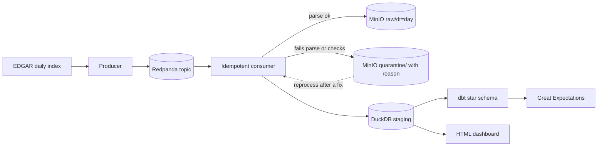

# edgar-stream

> Streaming ingestion of SEC EDGAR filings into a DuckDB star schema, with quality checks and measured freshness. Topics: data-engineering, redpanda, kafka, duckdb, dbt, airflow, great-expectations, sec-edgar

A personal data engineering project: it keeps a small filings warehouse fresh as new 10-K, 10-Q and 8-K filings arrive, and reports how fresh and how clean it is.


## Results

Replay of 5 real EDGAR days (2026-10-19 to 2026-10-23, 200 filings sampled per day, 1000 events) through Redpanda and MinIO on a laptop. Command: `make stack-up && make eval`, output in `results/replay_results.json`.

| Run | Events | Events/s | Freshness p50 | Freshness p95 | Duplicates dropped | Older version kept in history | Quarantined |
|---|---|---|---|---|---|---|---|
| Paced at 25 events/s | 1045 | 24.8 | 638 ms | 1840 ms | 45 | 2 | 2 |
| Burst, newest day first | 1045 | 36.2 | 14.3 s | 27.2 s | 45 | 6 | 2 |

- Freshness is event publish time to queryable in DuckDB. The burst run includes queue wait, so read the paced row as steady state.
- The 45 duplicates are 5 percent redelivery that the producer injects on purpose. The 2 quarantined files are real: `no_sections_found` (one 10-Q, one 8-K).
- Warehouse: 998 filing versions, 2924 sections, 839 companies, 6 forms, 317 dates. All 22 load batches passed Great Expectations, and 11 checks on the star tables passed after `dbt build` (21 nodes, 2.8 s).
- 285 of 998 filings were cut at 1.5 MB when downloaded (mostly 10-Q and 10-K), so their later sections are missing.

## How it works



The index gives one event per filing. The consumer fetches the file, parses the SEC header and `Item` sections, runs a Great Expectations gate on the batch, lands the raw file in MinIO by filing date, and commits the rows to DuckDB in one transaction. Kafka offsets are committed only after that commit. Rows that fail parsing or the gate go to `quarantine/` with a JSON file holding the reason. `make reprocess` runs them through the current parser, and files are deleted from quarantine only after they load. Airflow runs the daily DAG and a backfill DAG over a date range, with 3 retries.

## Design choices

- **Dedupe key is accession plus version.** A repeated event is dropped. A filing is also versioned by form: an amended filing (10-K/A) is a newer version of the same company, form and period. Older versions stay in history, but the current pointer only moves forward, so arrival order does not matter (property tests check this).
- **8-Ks have no period, so they match on company, event date and item list.** I first keyed them on company and date only and found different 8-Ks filed on the same day were treated as versions of each other.
- **DuckDB instead of PySpark.** The data is a few thousand rows per day. DuckDB runs the transforms in one process and keeps memory under a few hundred MB next to the other services.
- **Great Expectations runs twice:** on each load batch before commit (bad rows are quarantined) and on the star tables after dbt.
- **A parser bug I found by replaying real days:** headings written with thin spaces (`Item&#8201;1.01`) did not match, so valid 8-Ks went to quarantine. The fix is in `parse.py` and has a test.

## Run it

No keys, no network, no containers needed for the demo (Python 3.12 or 3.13):

```bash
python -m venv .venv && . .venv/bin/activate
pip install -r requirements.txt && pip install -e . --no-deps
make demo            # replays the committed sample, builds the star schema, writes site/index.html
make dashboard       # serves it at http://localhost:8501
```

The sample (`sample/days`) is 28 real filings from 5 days, 3 of them altered on purpose (labelled in `sample/faults.json`). `make demo` delivers the newest day first with 10 percent duplicates, so you see a duplicate drop, an older version arrive late and 3 quarantined files.

With Redpanda and MinIO (ports 19092 and 9100, about 0.5 GB):

```bash
make stack-demo                          # same sample through Redpanda and MinIO
docker compose --profile airflow up -d   # Airflow at http://localhost:8090 (about 1.4 GB)
make stack-down                          # docker compose down -v
```

To fetch real days, copy `.env.example` to `.env` and set `EDGAR_USER_AGENT` to your name and email, as the SEC requires. Requests are limited to under 10 a second. Then run `edgar-stream fetch --dates 2026-10-23` and `make eval`.

## Tests

`make test` runs 34 pytest cases on the committed sample and generated data, including Hypothesis tests that shuffle and duplicate events and check the warehouse ends in the same state. `make lint` runs ruff. CI runs both on Python 3.12 and 3.13, then `make demo`.

## What I'd do next

- Match 8-K amendments on the filing text, not the item list.
- Download full filings instead of the first 1.5 MB, and parse the financial data tags.
- Run more than one consumer with a Postgres warehouse, since DuckDB allows one writer.
- Add lag and error metrics to Redpanda and alert on freshness.
