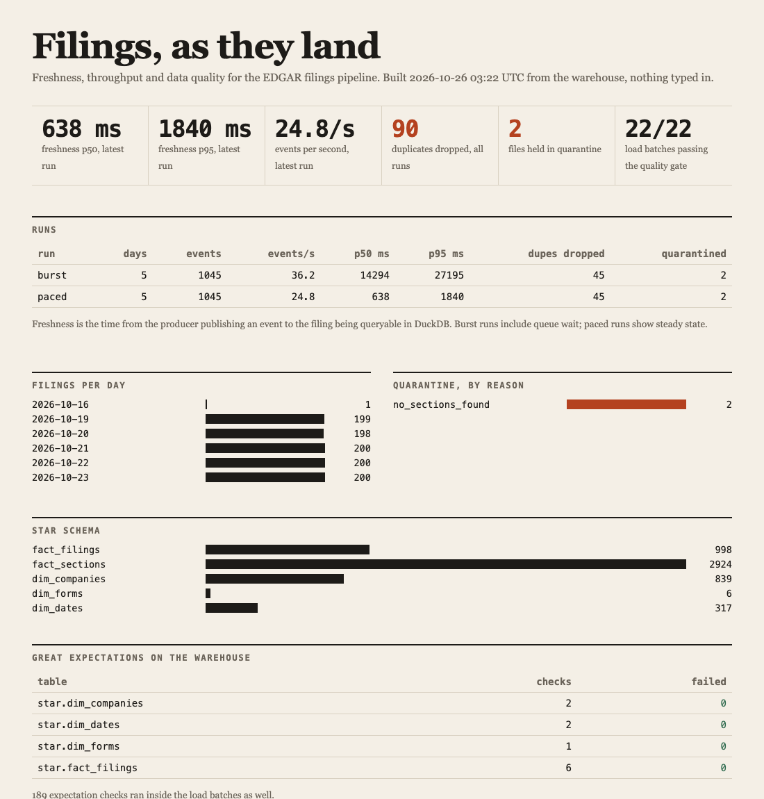
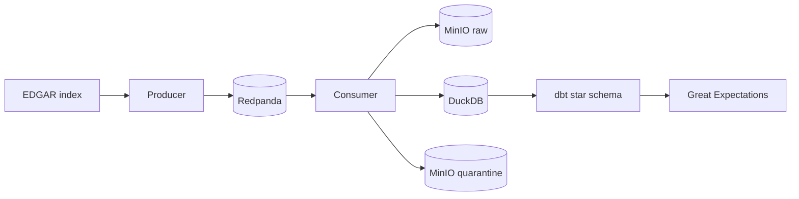

# edgar-stream

A personal project that streams SEC EDGAR filings into a DuckDB star schema, with quality checks and measured freshness.

Topics: data-engineering, redpanda, kafka, duckdb, dbt, airflow, great-expectations, sec-edgar



## Results

Replay of 5 real EDGAR days (1045 events) on a laptop. Command: `make stack-up && make eval`.

| Run | Events/s | Freshness p50 | Freshness p95 | Duplicates dropped | Quarantined |
|---|---|---|---|---|---|
| Paced at 25 events/s | 24.8 | 638 ms | 1840 ms | 45 | 2 |
| Burst, newest day first | 36.2 | 14.3 s | 27.2 s | 45 | 2 |

285 of 998 filings were cut at 1.5 MB when downloaded, so their later sections are missing. Warehouse counts and caveats: [docs/RESULTS.md](docs/RESULTS.md).

## How it works



- The index gives one event per filing; the consumer fetches and parses the SEC header and `Item` sections.
- A Great Expectations gate checks each batch, and rows are committed to DuckDB in one transaction.
- Kafka offsets are committed only after that commit.
- Rows that fail parsing or the gate go to `quarantine/` with a JSON reason; `make reprocess` retries them.
- Airflow runs the daily DAG and a backfill DAG, with 3 retries. More in [docs/DESIGN.md](docs/DESIGN.md).

## Design choices

- **Dedupe on accession plus version**, so arrival order does not matter (property tests check this).
- **8-Ks match on company, event date and item list**, because same-day 8-Ks were wrongly treated as versions of each other.
- **DuckDB instead of PySpark**, since the data is a few thousand rows per day and memory stays under a few hundred MB.
- **Great Expectations runs twice**, before commit (bad rows are quarantined) and on the star tables after dbt.

## Run it

No keys, no network, no containers needed for the demo (Python 3.12 or 3.13):

```bash
python3.13 -m venv .venv && . .venv/bin/activate   # or python3.12
pip install -r requirements.txt && pip install -e . --no-deps
make demo            # replays the committed sample, builds the star schema, writes site/index.html
make dashboard       # serves it at http://localhost:8501
```

The sample (`sample/days`) is 28 real filings from 5 days, 3 of them altered on purpose (labelled in `sample/faults.json`). `make demo` delivers the newest day first with 10 percent duplicates, so you see a duplicate drop, an older version arrive late and 3 quarantined files.

With Redpanda and MinIO (ports 19092 and 9100, about 0.5 GB):

```bash
make stack-demo                          # same sample through Redpanda and MinIO
docker compose --profile airflow up -d   # Airflow at http://localhost:8090 (about 1.4 GB)
make stack-down                          # docker compose down -v
```

To fetch real days, copy `.env.example` to `.env` and set `EDGAR_USER_AGENT` to your name and email, as the SEC requires. Requests are limited to under 10 a second. Then run `edgar-stream fetch --dates 2026-10-23` and `make eval`.

## Tests

`make test` runs 35 pytest cases on the committed sample and generated data, including Hypothesis tests that shuffle and duplicate events and check the warehouse ends in the same state. `make lint` runs ruff. CI runs both on Python 3.12 and 3.13, then `make demo`.

## What I'd do next

- Match 8-K amendments on the filing text, not the item list.
- Download full filings instead of the first 1.5 MB, and parse the financial data tags.
- Run more than one consumer with a Postgres warehouse, since DuckDB allows one writer.
- Add lag and error metrics to Redpanda and alert on freshness.
